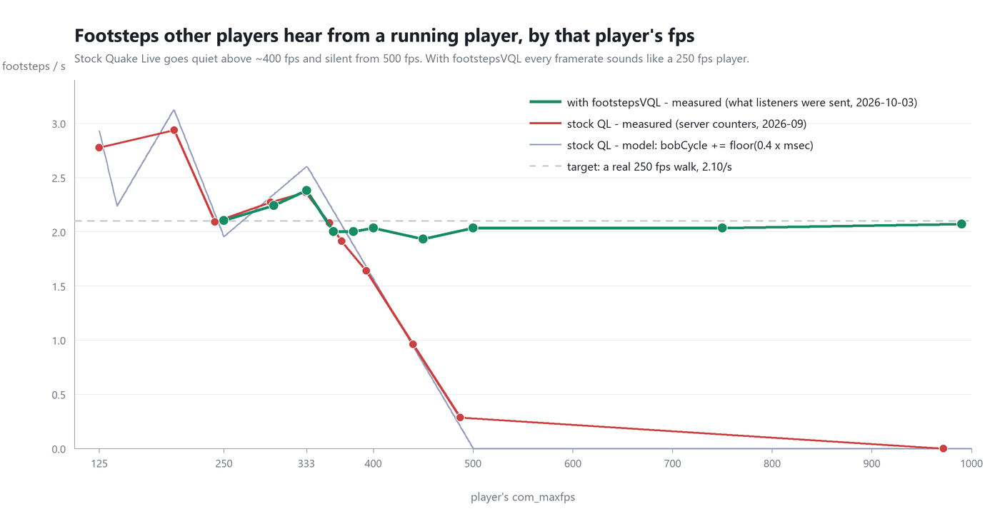

# footstepsVQL — footsteps for high-fps Quake Live players, without the doubled sounds

A server-side fix for Quake Live (minqlx and minqlxtended). Players running at
high `com_maxfps` make no footstep sounds in stock QL. Above about 500 fps they
are completely silent. footstepsVQL makes every player sound to everyone else
like a player at 250 fps, and never changes what a player hears from himself.
It replaces `footsteps250` 2.1, which made high-fps players audible but doubled
their own jump and shot sounds.

**Release:** footstepsVQL 1.1, `footstepsVQL_hook.so` `c96f49decdef…` +
`footstepsVQL.py` `7ce3da41db70…`, 2026-10-07. **In production on four
community servers** (one LG duel, three CA) since 7–11 October 2026: 553 map
loads and 47 restarts with 0 install failures, and at least 126,754 footsteps
delivered to listeners (see [In production](#5-in-production)).



- [1. What the fix does, and why](#1-what-the-fix-does-and-why)
- [2. Footsteps vs fps](#2-footsteps-vs-fps)
- [3. How it was tested, and the results](#3-how-it-was-tested-and-the-results)
- [4. Performance](#4-performance)
- [5. In production](#5-in-production)
- [Install](#install) · [Commands and cvars](#commands-and-cvars) · [Known limits](#known-limits) · [Repository](#repository)

---

## 1. What the fix does, and why

### The bug in stock Quake Live

Footsteps come from the player's movement code. Every user command advances a
counter, `bobCycle`, and a footstep plays each time it crosses a 128-unit
boundary:

```c
old = ps->bobCycle;
ps->bobCycle = (int)(old + bobmove * pml.msec) & 255;   // bobmove = 0.4 when running
if (((old + 64) ^ (ps->bobCycle + 64)) & 128)
    PM_AddEvent(PM_FootstepForSurface());
```

`old` is an integer, so each command adds `floor(0.4 × msec)` and throws the
fraction away. A command is one client frame, so its length depends on fps:

| Client fps | Command length | Units added per command | Footsteps/s |
|---|---|---|---|
| 250 | 4 ms | 1 | 1.95 |
| 333 | 3 ms | 1 | 2.60 |
| 400 | 2–3 ms | 0 or 1 | ~1.6 |
| 500 | 2 ms | 0 | **0** |
| 1000 | 1 ms | 0 | **0** |

So a player above ~400 fps gets quieter, and one at 500 fps or more never
plays a footstep at all. Nobody hears him coming. That's a real advantage, and
on a public server it's an unfair one.

### Why the earlier fix doubled sounds

`footsteps250` 2.1 fixed the silence by rewriting `bobCycle` on the server so
it advances at the 250 fps rate. That makes footsteps audible, but the player's
own client predicts its movement with the stock code, so client and server now
disagree about `bobCycle`. QL matches the client's predicted events against the
server's through a two-slot event queue in the player state, and the matching
only works when both sides agree. A footstep the client did not predict slides
into that queue, shifts it, and the jump or shot in the other slot is played a
second time. That replay is the doubled sound. Measured with an instrumented
client: 9 replays in 689 of the player's own events.

### What footstepsVQL does instead

Three rules:

1. **Never touch what the client predicts.** `bobCycle` stays stock, bit for
   bit, so the player's own client and the server always agree. The hook keeps
   its own cadence in private server memory.
2. **Add footsteps only for other players.** When a fast player owes a
   footstep, the hook writes it into his event queue at the point where the
   server copies events into what other players receive. It takes it back out
   before his own snapshot is built. Everyone else hears it; he never sees it,
   so his prediction is never disturbed.
3. **Above ~355–390 fps, other players hear a steady clock.** Stock footsteps
   are irregular in this band. Instead of patching the gaps, the hook strips
   them from what other players receive and sends one footstep every 476 ms
   (2.10/s), the tempo of a real 250 fps run. Below ~320 fps nothing is changed
   and the player sounds stock. The band in between has hysteresis, so a player
   near the line does not flap between the two.

The clock obeys the same rules stock footsteps do:
- nothing while walking, crouching, in water, or with footsteps disabled;
- nothing in the air: bunnyhops, strafe-jumps and jump pads stay silent in
  flight, as in stock;
- at least 200 ms after any other footstep, including a landing.

**Note: spectators following a player hear what that player hears, not the
clock.** A spectator in follow mode is sent the followed player's own player
state, not his entity as other players see it, and rule 1 keeps that player
state stock. So the spectator hears the followed player's stock footsteps,
which above ~500 fps means none, while everyone in the game hears the clock.

**Safety.** The hook finds its two patch points in `qagamex64.so` by byte
signature, not address. It installs both or neither, and refuses with a status
code if a signature is missing or matches twice. A built-in self-test must pass
before anything is installed. It re-installs after every map change, restart
and match start, and `!fsvunload` puts the original bytes back immediately.

| | Result |
|---|---|
| Other players hear a fast player | a steady 2.10/s, like a 250 fps player |
| Other players hear a player below ~320 fps | stock QL, unchanged |
| The player hears himself | stock QL, unchanged — nothing is ever added |
| Doubled jumps, shots or footsteps | none, measured for both the player and the listeners |

## 2. Footsteps vs fps

The chart at the top shows the whole story. Running on flat ground:

- **Grey: the stock formula.** A sawtooth: rising and falling up to 333 fps,
  then a steep fall to zero at 500 fps.
- **Red: stock QL, measured** on the server: 2.09/s at 241 fps, 0.96/s at 440,
  0.29/s at 487, and 0 at 972 fps.
- **Green: with footstepsVQL, measured** as what other players were actually
  sent: 1.93–2.10/s from 360 to 990 fps, at the 2.10/s target. Below the switch
  it follows stock exactly, because there it is stock.

The two measured series come from different instruments. Stock is from the
server's own footstep counters (September 2026); footstepsVQL is from listener
snapshots (October 2026, method below). Both are 30–60 s of running per point.

## 3. How it was tested, and the results

### Summary

| What | How | Result |
|---|---|---|
| Other players hear the right rate | Listener bots, 250–990 fps, flat ground | 2.0–2.1/s from 400 fps up; 250–333 fps unchanged |
| No doubles for other players | Same, plus stairs, bunnyhop, strafe-jump, run-jump-fire, jump pad and CA | 0% near-doubles, apart from one 25 ms pair in 30 s of 990 fps stairs |
| No doubles for the player himself | Instrumented client (`ql_sndtap`), 250/360/400/990 fps | **0 replays in 5699 events** (footsteps250 2.1: 9 in 689) |
| Nothing lost, nothing left behind | Server counters over the whole session | 2133 injected, 2133 delivered, 0 left in the player's queue |
| Network delay doesn't matter | The same runs at 0 and 50 ms added | Same results |
| Stock players untouched | Runs at 250–333 fps | 0 injected, 0 stripped |
| Server cost | Benchmark of the hook against the real qagame | ~50 ns per command |
| Code gates (1.1) | Host self-test, structural self-test, signature probe | 56 cadence cells + 187 checks, 0 failures |
| In production | Four community servers, 7–17 October 2026 | 0 install failures in 553 map loads; ≥ 126,754 footsteps delivered |
| By ear | The tester listened through the whole session | nothing unusual |

### Test setup

**Listeners.** Four bots, frozen with `bot_pause` around a map
(`thunderstruck`), are the listeners. A recorder
([`server/botsnap.py`](server/botsnap.py)) reads every snapshot the server
builds for each bot straight out of the server process's memory, 40 times a
second. It then applies the same rules cgame uses to decide which events play.
The result is exactly what a human standing where that bot stands would be
sent and would play. Bots are ideal for this:
- they don't move;
- all four receive the same stream, so any difference between them is a
  measurement error (there were none);
- they cost nothing to run.

Network loss between server and listener is not modelled, and neither is
distance falloff. This measures what is sent.

**Runs.** The tester plays one human client. Typing `250 flat start` or
`990 stair start` in chat starts a 30 s run, and a conductor
([`server/conductor.py`](server/conductor.py)) marks it in server time and says
when it's over. `rtt 50` adds 50 ms of round-trip delay with `tc netem`.

**What we count**, per run:
- footsteps per second heard;
- seconds with 1, 2, 3 or 4+ footsteps;
- the median gap between footsteps;
- **near-doubles**, gaps under 150 ms, which a listener hears as a double;
- **holes**, gaps over 700 ms;
- the hook's own counters: injected, delivered, stripped, deferred, and left
  in the player's queue.

For jump-heavy movement we also divide by the time actually spent on the
ground, because stock is silent in the air too.

**Mover check.** `ql_sndtap` (in [`native/`](native/)) hooks into the tester's
own client and logs every event the client plays, with a microsecond clock.
[`scripts/_replay_signature.py`](scripts/_replay_signature.py) then counts
**true replays**: the same event played again within 40 ms of its first play,
landing within 100 µs of another event in the same drain. That signature is
exactly how `footsteps250`'s doubles look (9 in 689 events). Its 40 ms window
is the one that separates a replay from the next real shot.

**Offline gates**, run on the server host before every build:
- [`server/test_cadence.c`](server/test_cadence.c): 56 cadence cells. These
  cover every command length from 1 to 8 ms and mixed lengths, the listener
  clock at 400–1000 fps, 16 stair cells (ground stretches, drops and
  landings), 12 stairs-then-flat cells and 6 cells with jumps and landings as
  events. Each cell checks that `bobCycle` matches a pure stock simulation
  exactly, that the rate never falls below a 250 fps player, that a stock
  player gets no injections, that no injection lands within 200 ms of
  another footstep, and that no two injections are closer than 350 ms.
- [`server/selftest_emit.py`](server/selftest_emit.py): 187 checks against the
  real `qagamex64.so` in a throwaway process. It covers:
  - the stub that keeps the second patch site in reach, including a run with
    qagame loaded 3 GB from the hook (1.0 refuses there; 1.1 installs);
  - both patch sites found and restored byte for byte;
  - the queue write and undo;
  - stripping from listeners, and the overflow path;
  - holding a footstep back when the queue is full;
  - walk, crouch and water silence;
  - stairs;
  - failing safely when memory protection can't be changed.
- [`server/probe_sigs.sh`](server/probe_sigs.sh): all 7 signatures unique in
  the shipped qagame.
- A shim test of the plugin on both minqlx and minqlxtended
  ([`scripts/_plugin_shim_test.py`](scripts/_plugin_shim_test.py)), and a
  static review of the plugin
  ([`scripts/_plugin_review_check.py`](scripts/_plugin_review_check.py)).

### Results

All on `d6d28bed`, with 4 listener bots, 30 s runs, and 0 ms added unless
noted. The builds since then were re-tested live on the parts they change:
stairs, and jump pads with and without LG. 1.1 itself, at ~1000 fps: 2.08
footsteps/s on flat ground, 3.12/s on stairs, 0 near-doubles, and every
injected footstep delivered.

**Flat ground, by fps:**

| fps | Path | Footsteps/s | Seconds on exactly 2 | Median gap | Near-doubles | Holes | Injected / stripped | Verdict |
|---|---|---|---|---|---|---|---|---|
| 250 | stock | 2.103 | 83% | 475 ms | 0% | 0% | 0 / 0 | PASS: stock, untouched |
| 300 | stock | 2.241 | 69% | 450 ms | 0% | 0% | 0 / 0 | PASS: stock, untouched |
| 333 | stock | 2.379 | 52% | 400 ms | 0% | 0% | 0 / 0 | PASS: stock, untouched |
| 360 (coming down from 500) | clock | 2.000 | 90% | 475 ms | 0% | 0% | 58 / 58 | PASS: 250 fps rhythm |
| 400 | clock | 2.034 | 86% | 475 ms | 0% | 0% | 60 / 45 | PASS: 250 fps rhythm |
| 450 | clock | 1.931 | 86% | 475 ms | 0% | 0% | 56 / 25 | PASS: 250 fps rhythm |
| 500 | clock | 2.034 | 90% | 475 ms | 0% | 0% | 59 / 10 | PASS: 250 fps rhythm |
| 750 | clock | 2.034 | 90% | 475 ms | 0% | 0% | 61 / 2 | PASS: 250 fps rhythm |
| 990 | clock | 2.069 | 86% | 475 ms | 0% | 0% | 59 / 0 | PASS: 250 fps rhythm |

At 50 ms added, 250 and 990 fps flat gave 2.069 and 2.034/s, with no
near-doubles or holes.

**Stairs.** These found the last bug. On the build before this one, a stock
250 fps player got 18 clock footsteps in 30 s of stairs, four of them 25 ms
from a landing footstep. The cause: time in the air between steps was counted
as running time. The release counts only each command's own length, and treats
a landing as a footstep for the 200 ms gap:

| | Build | Footsteps/s | Near-doubles | Injected | Verdict |
|---|---|---|---|---|---|
| 250 fps stairs | previous | 3.000 | **14%** | 18 | FAIL: fixed in the release |
| 250 fps stairs | release | 3.000 | **0%** | 1 | PASS |
| 990 fps stairs | release | 2.966 | 1% (one 25 ms pair) | 33 | PASS: the pair is a known limit |

Across 25 stair runs at 250–990 fps, at 0 and 50 ms added, the rate stayed at
2.9–3.2/s for stock and clock alike. There were 0% near-doubles, and at most
2% holes.

**Jumping.** Seconds on the ground (of 29), then footsteps per ground second:

| Movement | 250 fps (stock) | 400 fps | 990 fps | Verdict |
|---|---|---|---|---|
| Bunnyhop | 9.7 s, 1.95 | 7.5 s, 1.86 | 9.1 s, 1.98 | PASS (the 400 fps pass wasn't clean: a fall and jumped stairs) |
| Strafe-jump | 5.5 s, 2.00 | 4.9 s, 2.24 | 6.2 s, 2.11 | PASS |
| Run, jump and fire | 13.7 s, 2.12 | 12.5 s, 2.08 | 10.1 s, 1.79 | PASS |
| Jump pad, repeated | 3.6 s, 1.94 | 5.3 s, 1.50 | 3.5 s, 1.98 | PASS (7–8 footsteps per run, a small sample) |

No near-doubles anywhere. The clock never fires in the air: the 990 fps
bunnyhop's 19 clock footsteps were all on ground time.

**CA, 5 v 5 with live bots,** at 250, 400 and 990 fps: 0% near-doubles at
every fps. 121 footsteps injected and 121 delivered.

**Mover check** with `ql_sndtap`, firing, jumping and running stairs at every
fps:

| fps | Player's own events | True replays | Verdict |
|---|---|---|---|
| 250 | 1133 | 0 | PASS |
| 360 | 1491 | 0 | PASS |
| 400 | 1196 | 0 | PASS |
| 990 | 1879 | 0 | PASS |
| **all** | **5699** (5139 shots, 217 footsteps, 183 jumps, 131 landings) | **0** | **PASS** (footsteps250 2.1: 9 in 689, FAIL) |

**Server counters, whole session** (1 h 45 min, every run above): 2133
footsteps injected, 2133 delivered, 2133 taken back out of the player's queue,
0 left behind.

### Why we consider it passed

- **It does what it promises.** From 400 to 990 fps, other players heard
  1.93–2.07/s on flat ground, against a 2.10/s target. That's 86–90% of seconds
  on exactly two footsteps, with a 475 ms median gap: a 250 fps player's rhythm.
- **It leaves stock alone.** At 250–333 fps there were 0 injections and 0
  strips in every run.
- **No doubles for anyone.** For listeners: 0% near-doubles in every run on
  flat ground, jumps, jump pads and CA, and one 25 ms pair in 87 footsteps on
  990 fps stairs. For the player himself: 0 replays in 5699 events, measured
  in his client.
- **Nothing lost or left behind.** Delivered equals injected, and nothing was
  left in the player's queue. Anything left there is the one way the hook could
  cause a doubled sound for the player.
- **It follows stock's rules.** No footsteps in the air. The same per-ground-second
  rate as stock 250 for every movement style. Silent walking and crouching are
  covered by the structural self-test, and were measured live on an earlier
  build at 0.
- **It doesn't depend on ping.** 0 and 50 ms added gave the same numbers. The
  fix runs on the server from the player's commands, and delay doesn't change
  their length.

## 4. Performance

Measured with [`server/perf_bench.c`](server/perf_bench.c) on an 8-core Xeon
(Icelake) VPS. It runs the hook against a private copy of the real qagame, with
every path live: the bob site, the queue write and undo, and the strip.

| | Cost |
|---|---|
| Hook code per command | 28–33 ns — the same for 1, 8, 16 or 32 players and 1–4 ms commands |
| Register save and restore around the call | ~20 ns |
| **Total per command (upper bound)** | **~50 ns** |
| 32 players all at 1000 fps (32,000 commands/s) | **1.6 ms of CPU per second, 0.16% of one core** |
| Per server frame at `sv_fps 40` (25 ms), 32 players at 1000 fps | ~40 µs |
| The same, as a share of one 25 ms server frame (800 commands × ~50 ns) | **~40 µs of 25 ms: 0.16% of the frame** |
| Install at plugin load (self-test + signature scan) | 15 ms, once per load |
| Re-install on map change | ~6 ms, during the map load |

**Why a full 32-player, 1000 fps server doesn't notice it:**
- **The work per command is fixed and tiny:** some integer arithmetic, a
  lookup in a 256-entry table, and at most a few memory writes. It doesn't grow
  with players, fps or match length; the benchmark is flat from 1 to 32
  players.
- **Nothing in the hot path can block.** No system calls, no locks, no
  allocation, no I/O. The library imports only `dl_iterate_phdr`, `mprotect`,
  `mmap`, `munmap`, `memset` and `strstr`, used at install time. It cannot
  write a file or a socket.
- **The plugin does nothing per frame.** It has no frame hooks. It prints one
  line at load and stays quiet after that (per-map lines only with
  `qlx_footstepsVQLVerbose 1`). Its only file work is copying the library to
  the temp directory at load.
- **The hook is small next to what a fast player already costs.** A 1000 fps
  player already makes the server run the full movement code 4× as often as a
  250 fps player. That's Quake Live, with or without this fix, and the hook's
  ~50 ns is a small fraction of each of those commands.
- **The counters stay in.** They are what `!fsvstatus` reports, and they cost
  a few nanoseconds of the 30.

## 5. In production

footstepsVQL runs on four community servers: one LG duel server and three
CA servers, all on minqlxtended. Two of the CA servers replaced
`footsteps250` with it. Read-only checks of each server's journal and logs,
last on 2026-10-17:

| Server | 1.1 since | Restarts | Map loads | Install failures | Footsteps delivered | Busiest hour |
|---|---|---|---|---|---|---|
| LG duel (earlier builds since 28 Sep) | 8 Oct | 26 | 61 | 0 | ≥ 78,597 | 7.4 players |
| CA 1 | 7 Oct | 4 | 163 | 0 | ≥ 30,793 | 12.9 |
| CA 2 | 10 Oct | 9 | 182 | 0 | ≥ 13,258 | 16.5 |
| CA 3 | 11 Oct | 8 | 147 | 0 | ≥ 4,106 | 15.4 |
| **All four** | | **47** | **553** | **0** | **≥ 126,754** | |

- **Every map load re-installs the hook,** so 553 map loads are 553
  installs against a freshly mapped game library. None refused.
- **Delivered is a lower bound:** the counters reset at every restart, and
  only runs caught by a check are counted. 3 footsteps showed as injected but
  not yet delivered at the moment of a check; a check during play can catch
  one in flight.
- **Busiest hour** is the highest 60-minute average of connected players,
  spectators included, bots not.
- **The one production failure was on 1.0:** on CA 3, before its upgrade, a
  map change put the game library out of reach of the second patch site, and
  the hook refused safely and left that map stock. That is the bug 1.1
  fixes, and CA 3's row counts from its 1.1 install.
- **The hold-back in heavy combat works live:** before 1.1, the LG duel
  server counted 97 and 596 footsteps that waited one command for room on two
  days, with every injected footstep delivered.

Details per server are in [`RELEASE.md`](RELEASE.md), *In production*.

## Install

1. Copy `footstepsVQL_hook.so` and `footstepsVQL.py` from [`release/`](release/)
   into your plugin directory (`minqlx-plugins/` or `minqlxtended-plugins/`).
   Keep the `_hook` suffix: a file named `footstepsVQL.so` would shadow the
   plugin.
2. In `qlx_plugins`, replace `footsteps250` with `footstepsVQL`, or just add
   it.
3. Restart the server or change map.
4. The console shows two lines:
   `[footstepsVQL] version 1.1: .so c96f49de, .py 7ce3da41` and
   `[footstepsVQL] plugin load: hook installed (qagame base …, site …, ring …)`.
   In game, `!fsvstatus` shows the same version line and says the patch is
   active.

No configuration is needed.

**Upgrade:** replace both files, then `!reload footstepsVQL` or change map.
**Rollback:** `!fsvunload` restores stock bytes at once. Alternatively, remove
the plugin from `qlx_plugins` and change map.

**Compatibility.** One `.so` for minqlx and minqlxtended. It needs only glibc
2.4, so it runs on Ubuntu 24.04, Debian 12 and the Ubuntu 16 minqlx containers.
The signatures are verified against `qagamex64.so` `091d568f46a2…`, the current
Steam build. On any other build the hook refuses to install and the server
stays stock.

## Commands and cvars

| Command | Perm | |
|---|---|---|
| `!fsvstatus` | 1 | the version and build hashes, what is loaded and patched, and the counters (alias `!footstepsvql`; one reply per 5 s) |
| `!fsvstatus reset` | 1 | report, then zero the counters |
| `!fsvload` | 2 | apply now and on future maps |
| `!fsvunload` | 2 | restore stock bytes now and stop re-applying |

| Cvar | Default | |
|---|---|---|
| `qlx_footstepsVQLEnabled` | `1` | `0` leaves the server stock |
| `qlx_footstepsVQLSo` | empty | absolute path to the `.so`, if it isn't next to the plugin |
| `qlx_footstepsVQLVerbose` | `0` | `1` also logs the routine per-map lines |

## Known limits

None of these can double a sound. The worst any of them does is move or drop
a single footstep.

- **The moment the clock takes over, coming up from below.** In the second the
  switch happens, one gap can exceed 700 ms. This happens once per switch, and
  never on the way down.
- **A clock footstep just before a landing.** The 200 ms gap protects the time
  after a landing; the clock can't know one is coming. Seen once in 30 s of
  990 fps stairs, as a 25 ms pair.
- **A full event queue in heavy combat.** The hook holds the footstep back one
  command (1–4 ms) instead of losing it. Proven offline, and seen working on
  the production servers (see [In production](#5-in-production)). Without it,
  about 1 footstep in 100 is lost in heavy combat: a missing footstep, not a
  double.
- **Sustained LG fire.** Listeners lose some footsteps, falls and jump pads
  while a player fires LG, in stock QL and with footstepsVQL alike: the
  player's entity carries one event per server frame, and a shot later in the
  same frame replaces it. Measured at 22% lost at 250 fps (stock) and 32% on
  the clock at 500 fps while firing, the same within noise, and 0% without
  fire. footstepsVQL doesn't fix this.
- **Spectators following a player** hear what that player hears, which is
  stock, not the clock.
- **Other qagame builds:** the hook refuses rather than patches.
- **minqlx:** an earlier build ran on minqlx in production from 2026-09-28.
  1.0 and 1.1 have run live on minqlxtended; on minqlx they are covered by
  the plugin shim test.

## Repository

| Path | What |
|---|---|
| [`release/`](release/) | the two files to install, and `SHA256SUMS.txt` |
| [`server/footstepsVQL_hook.c`](server/footstepsVQL_hook.c), [`server/fs_cadence.c`](server/fs_cadence.c) | the hook and its cadence core |
| [`server/footstepsVQL.py`](server/footstepsVQL.py) | the minqlx / minqlxtended plugin |
| [`server/build.sh`](server/build.sh), [`server/release_build.sh`](server/release_build.sh), [`server/validate.sh`](server/validate.sh) | build and gates (run on the Linux server host) |
| [`server/botsnap.py`](server/botsnap.py), [`server/conductor.py`](server/conductor.py), [`server/run_detail.py`](server/run_detail.py) | listener measurement and run marking |
| [`server/perf_bench.c`](server/perf_bench.c) | the performance benchmark |
| [`native/`](native/), [`scripts/_replay_signature.py`](scripts/_replay_signature.py) | the client-side mover check |
| [`scripts/_plugin_shim_test.py`](scripts/_plugin_shim_test.py), [`scripts/_plugin_review_check.py`](scripts/_plugin_review_check.py) | the plugin gates, run on any machine with Python 3 |
| [`RELEASE.md`](RELEASE.md) | full release notes: every change, every gate, every measurement |
| [`docs/footstep-rate.png`](docs/footstep-rate.png) | the chart, made by [`scripts/_readme_chart.py`](scripts/_readme_chart.py) |

Contact: ark · Discord [`arkadnik.`](https://discord.com/users/352928164780965891)

License: [MIT](LICENSE).
